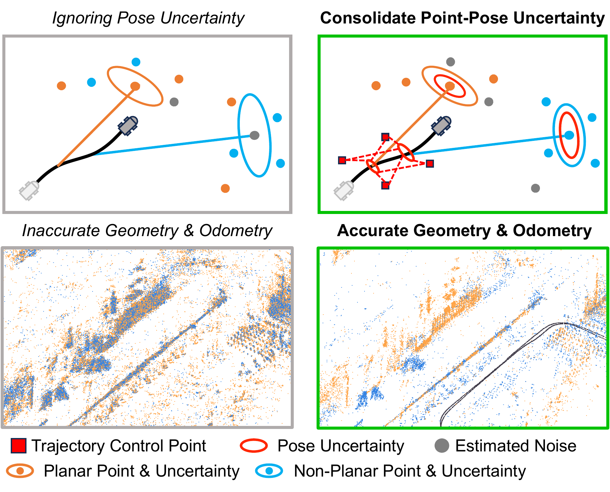
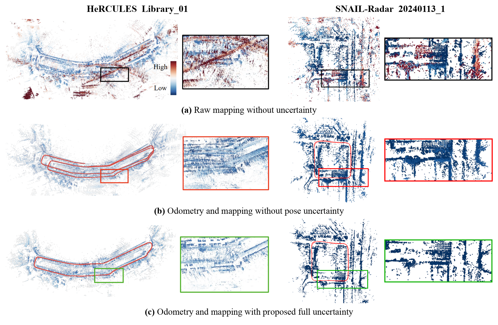

<p align="center">
  <h1 align="center">GeoRIO: Geometrically-Constrained Radar-Inertial Odometry via Continuous Point-Pose Uncertainty Modeling</h1>
  <p align="center"><a href="https://arxiv.org/abs/2604.02745">Arxiv</a> | <a href="https://ieeexplore.ieee.org/document/11455624">IEEE RA-L</a></p>
  </p> <p align="center">
    <a href="https://scholar.google.com/citations?hl=en&user=lh2KUKMAAAAJ"><strong>Wooseong Yang</strong></a>
    ·
    <a href="https://scholar.google.com/citations?hl=en&user=t_5U_98AAAAJ"><strong>Dongjae Lee</strong></a>
    ·
    <a href="https://scholar.google.com/citations?hl=en&user=aKPTi7gAAAAJ"><strong>Minwoo Jung</strong></a>
    ·
    <a href="https://scholar.google.com/citations?hl=en&user=7yveufgAAAAJ"><strong>Ayoung Kim</strong></a>
  </p>
  <div align="center"></div>
</p>

<p align="center">
  
</p>

## TL;DR

GeoRIO is a 4D radar–inertial odometry and mapping system that addresses unreliable map geometry when sparse, noisy scans are accumulated. Using a continuous-time trajectory, it jointly propagates measurement and pose uncertainty into the map frame to quantify each radar point’s reliability. This uncertainty is used to down-weight unreliable observations and replace uncertain map points with more reliable measurements. The resulting uncertainty-aware map enables effective point-to-plane registration and localizability-constrained state updates for accurate radar odometry.

<p align="center">
  
</p>
<p align="center">
  <em> Mapping results in Library_01 (HeRCULES) and 20240113_1 (SNAIL-Radar). Jointly consolidating point-pose uncertainty removes the ghosted double walls and noisy returns.</em>
</p>

## How to run

### 1. Git clone

```bash
cd <your directory>
git clone --recurse-submodules https://github.com/wooseongY/GeoRIO.git src
cd src
```

### 2. Docker Build

```bash
cd <your directory>/src
chmod +x ./docker/build_georio.sh ./docker/run_georio.sh
./docker/build_georio.sh
```

### 3. Docker run

```bash
cd <your directory>/src
./docker/run_georio.sh

```
`run_georio.sh` mounts:
- `<your directory> -> /root/ros2_ws`
- `<data directory> -> /root/data`

To override dataset path:

```bash
cd <your directory>/src
DATA_ROOT=/path/to/your/data ./docker/run_georio.sh
```

To override workspace root:

```bash
cd <your directory>/src
WORKSPACE_ROOT=/path/to/ros2_ws DATA_ROOT=/path/to/your/data ./docker/run_georio.sh
```

### 4. Build georio

Inside the container:

```bash
source /opt/ros/humble/setup.bash
cd /root/ros2_ws
rm -rf build install log
colcon build --packages-up-to geo_rio
source install/setup.bash
```

### 5. Launch

Inside the same container. Each launch file starts the node with one config and RViz:

```bash
ros2 launch geo_rio snail_radar.launch.py      # SNAIL-Radar, 4D radar + IMU
ros2 launch geo_rio hercules_radar.launch.py   # HeRCULES, 4D radar + IMU
ros2 launch geo_rio hkust_seq.launch.py        # HKUST, 4D radar + IMU
```

Then play the data in another terminal, e.g. `ros2 bag play <bag_dir>`. Each dataset has one
config for all of its sequences (`config_snail.yaml`, `config_hercules.yaml`, `config_hkust.yaml`).
To overlay a sequence's ground truth in RViz, set `gt_path` to that sequence.

### 6. Deterministic replay (recommended for evaluation)

```bash
# SNAIL-Radar and HKUST: a ROS 2 bag directory
ros2 run geo_rio GEORIO --ros-args \
    --params-file install/geo_rio/share/geo_rio/config/config_snail.yaml \
    -p offline_bag:=/root/data/snail/20240113/data1 \
    -p result_file_path:=evaluate/snail_20240113_1.txt \
    -p result_file_path_ns:=evaluate/snail_20240113_1_ns.txt

# HeRCULES: the dataset's raw sequence folder, read directly
ros2 run geo_rio GEORIO --ros-args \
    --params-file install/geo_rio/share/geo_rio/config/config_hercules.yaml \
    -p offline_hercules_dir:=/root/data/hercules/raw_data/Library/01 \
    -p result_file_path:=evaluate/hercules_library_01.txt \
    -p result_file_path_ns:=evaluate/hercules_library_01_ns.txt
```

The trajectory is written to `result_file_path` in TUM format (`timestamp tx ty tz qx qy qz qw`),
ready for `evo` or any TUM-compatible tool. Sequences of a dataset share the config, so pass
`result_file_path` (and `result_file_path_ns`) per run to keep each sequence's trajectory.

## Citation

If you use our paper for any academic work, please cite our paper.

```bibtex
@ARTICLE {wsyang-2026-ral,
    AUTHOR = { Wooseong Yang and Dongjae Lee and Minwoo Jung and Ayoung Kim },
    JOURNAL = { IEEE Robotics and Automation Letters (RA-L) },
    TITLE = { Geometrically-Constrained Radar-Inertial Odometry via Continuous Point-Pose Uncertainty Modeling },
    YEAR = { 2026 },
    VOLUME = { 11 },
    NUMBER = { 5 },
    PAGES = { 6098-6105 },
}
```

## Contact

If you have any questions, please contact:
- Wooseong Yang (Email: wseongy15@gmail.com)

## Credits

Our code is based on [RESPLE](https://github.com/asig-x/RESPLE).
